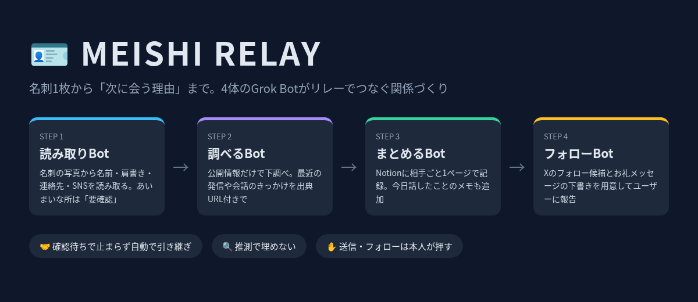

# MEISHI RELAY

名刺1枚から「次に会う理由」まで。4体のGrok Botがリレーでつなぐ関係づくり。

Grok Bot Tokyo Hackathon(2026-10-11)チーム6の成果物・記録まとめです。

## 概要

名刺の写真を1枚送ると、4体のBotが順番にバトンを渡し、「下調べ → Notion記録 → お礼の下書き」までを自動で仕上げるチーム構成です。Bot同士はSendToAgentで受け渡し、人に返ってくるのは最終報告の1回だけです。

| # | Bot | 役割 |
|---|-----|------|
| 1 | 読み取りBot | 名刺の写真から名前・会社・役職・連絡先を読み取る。あいまいな所は「要確認」 |
| 2 | 調べるBot | 公開情報だけで下調べ。最近の発信や会話のきっかけを出典URL付きで |
| 3 | まとめるBot | Notionに相手ごと1ページで記録。今日話したことのメモも追加 |
| 4 | フォローBot | Xのフォロー候補とお礼メッセージの下書きを用意してユーザーに報告 |

**共通ルール**: 読めない文字は推測しない / 調べるのは公開情報のみ・出典URL必須 / 送信・フォロー・つながり申請はBotは行わず本人が押す。

## ファイル一覧

| ファイル | 内容 |
|----------|------|
| `MEISHI_RELAY_team6.html` | 企画・提出資料(メイン) |
| `meishi-relay-presentation-v5.html` | プレゼン資料(最新版) |
| `meishi-relay-slides.html` | スライド資料 |
| `meishi-relay.html` | 企画ページ(軽量版) |
| `hackathon-meishi-v2.html` | 企画ページ(v2) |
| `meishi-relay-overview.png` | 概要図 |
| `team6-bot-templates.md` | 各Botの設定テンプレート |
| `team6-submission-draft.md` | 提出フォーム下書き |
| `meishi-team_masked.md` | チーム構成(個人情報マスキング済み) |
| `handoff-log_masked.md` | Bot間リレーの実測ログ(個人情報マスキング済み) |

## プライバシー

`*_masked.md` は相手の氏名・連絡先・非公開URLを伏せた公開用の版です。
