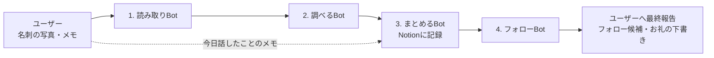

# 名刺チーム（チーム6）の構成と役割

名刺交換した相手について、名刺の読み取りからお礼の下書きまでを4つのBotがリレーで進めます。送信・フォロー・つながり申請は、どのBotもしません（押すのはユーザー本人）。

## 流れ

## 各Botの役割

| # | Bot | 受け取るもの | やること | 渡すもの | やらないこと |
|---|-----|-------------|---------|---------|-------------|
| 1 | 読み取りBot | ユーザーからの名刺の写真（あれば会った日・場所・メモ） | 名前、読み方、会社、肩書き、分野、連絡先、X・note・Webサイトなどを読み取る。書かれていない項目は「記載なし」、あいまいな項目は「要確認」。推測で埋めない | 読み取り結果・写真・メモを調べるBotへ | 調べ物、Notion記録、下書き、送信 |
| 2 | 調べるBot | 読み取りBotからの名刺情報・要確認項目・会った日と場所・メモ | 公開情報（Webサイト、note、Xなど）で下調べ。人物の概要と経歴、最近の発信（日付付き）、会話のきっかけ3〜5個、確認できなかった点を、すべて出典URL付きでまとめる。名刺のURLやアカウントから確実にたどれる情報だけを使い、同名の別人と混ぜない | 名刺情報と調査結果をまとめるBotへ（ユーザーの確認は待たない） | Notion記録、下書き、送信、フォロー |
| 3 | まとめるBot | 調べるBotからの名刺情報と調査結果、ユーザーからの今日のメモ | NotionのNotionの「名刺交換リスト」（URLは非公開）に相手ごとに1ページ記録（名前、会社、役職、メール、電話、URL、SNS、交換日、話題（出典URL付き）、メモ、お礼の状況） | 相手の情報・話題・メモ・NotionページURLをフォローBotへ | 調べ直し、下書き、送信 |
| 4 | フォローBot | まとめるBotからの名刺情報・話題・メモ・NotionページURL | 相手のXアカウントを公開情報で確かめ、本人かどうかの確度付きでフォロー候補を出す。お礼メッセージの下書きを作り、Notionの「お礼の下書き」欄に入れる | フォロー候補と下書きをユーザーへ報告（チームの最終報告） | フォロー、DM、メールの送信 |

## 共通ルール

- 共有はこのグループチャットで行う
- 推測で埋めず、分からない項目は「記載なし」「要確認」のまま残す
- 外部への送信・フォロー・つながり申請は、ユーザー本人が行う

## いまの状況（2026-10-11 13:30 JST 時点）

- Aさん（マスキング済み）: 読み取り・下調べ・Notion記録まで完了。今日話したことのメモ待ちで、届いたらフォローBotへ渡す
